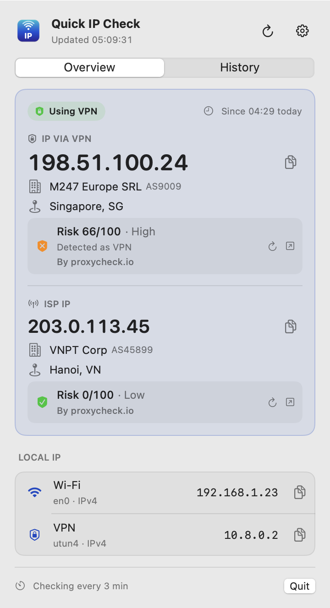
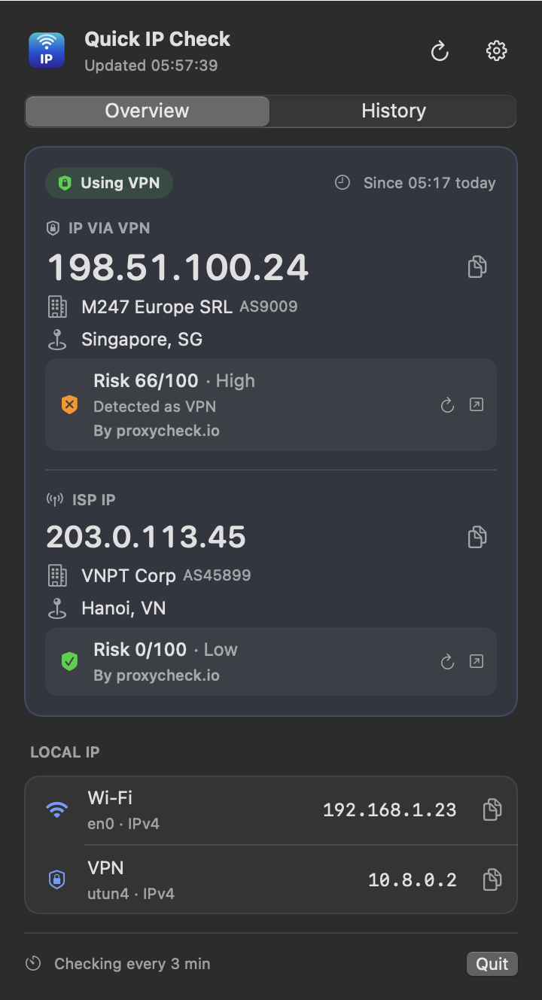
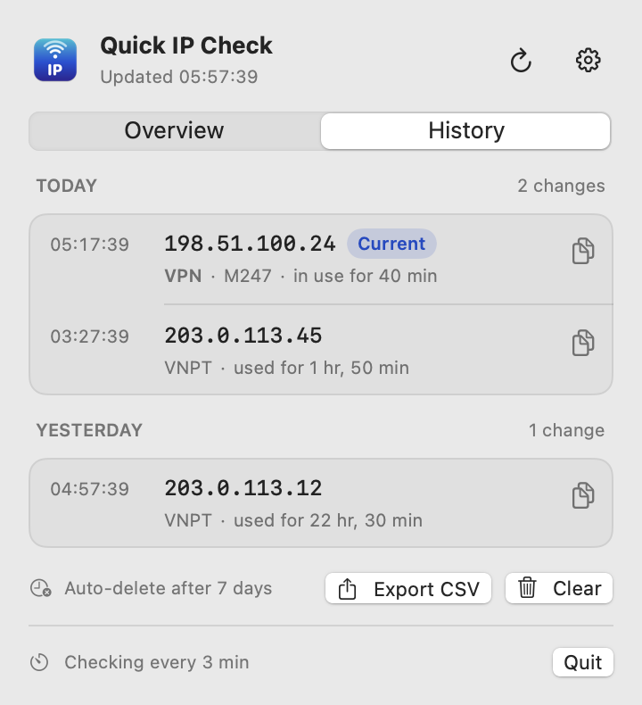
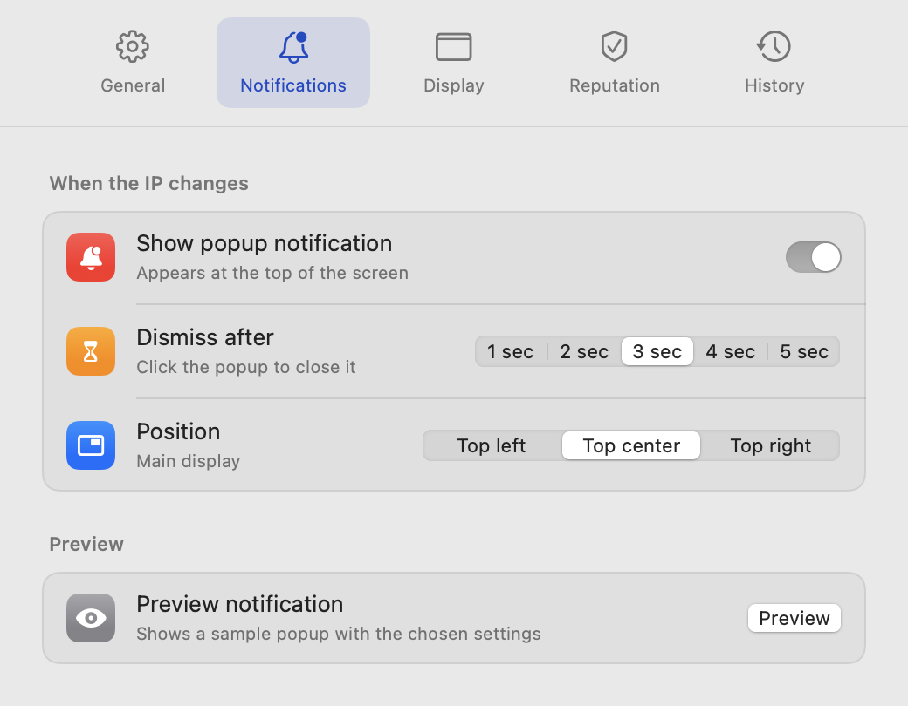
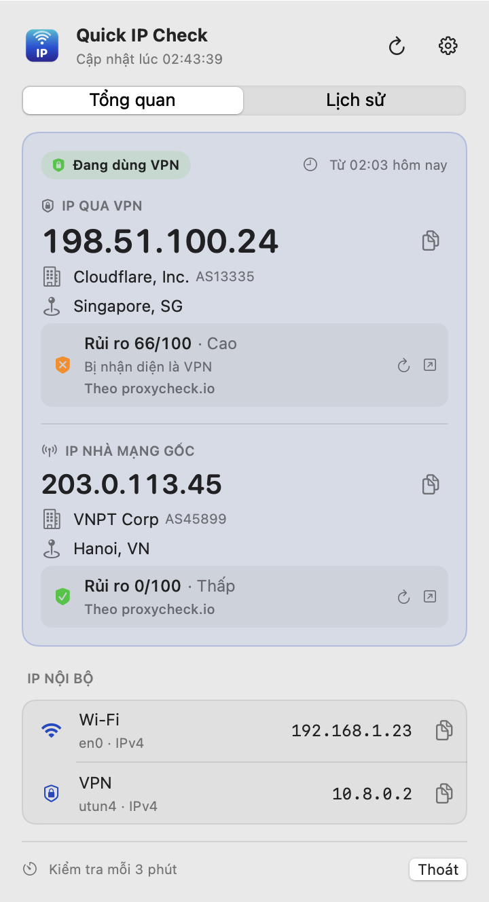

<p align="center">
  
</p>

<h1 align="center">Quick IP Check</h1>

<p align="center">
  Your public IP and ISP, right in the macOS menu bar.<br>
  Xem IP công khai và nhà mạng ngay trên thanh menu macOS.
</p>

<p align="center">
  <a href="https://github.com/Kaitiz/macos-quick-ip-check/releases/latest"><b>⬇ Download / Tải về</b></a>
  · macOS 13+ · Apple Silicon & Intel
</p>

<p align="center">
  
  
</p>

[English](#english) · [Tiếng Việt](#tiếng-việt)

---

## English

### Features

- **Menu bar at a glance** — shows `ISP · IP`, e.g. `VNPT · 203.0.113.45`.
- **VPN aware** — when a VPN is on, shows both the VPN IP and your original ISP IP.
- **Instant re-check** — detects when the network drops and comes back (or the Mac wakes) and checks right away; otherwise checks every 3 minutes (adjustable).
- **IP history** — recorded only when your IP changes, grouped by day, with how long each IP was used. Auto-cleanup after 6 h – 1 month and an optional entry limit. Export to CSV.
- **Returning IP** — tells you when you get an IP you used before (A → B → C → A), in the popup and on the overview.
- **Change popup** — a small notification when your IP changes, for 1–5 seconds, top left / center / right.
- **IP reputation** — risk score from proxycheck.io, fFraud, ip-api.com or StopForumSpam (no key needed), or AbuseIPDB and IPQualityScore (free API key).
- **Local IPs** — IPv4 / IPv6 per interface (Wi-Fi, Ethernet, VPN…).
- **One-click updates** — downloads, verifies and installs new versions when you agree.
- **English & Vietnamese**, light & dark mode, open at login.

<p align="center">
  
  
</p>

### Install

1. Download the latest `.dmg` from [Releases](https://github.com/Kaitiz/macos-quick-ip-check/releases/latest).
2. Open it and drag **Quick IP Check** into **Applications**.
3. Open the app from Applications. It lives in the menu bar (no Dock icon).

**"Apple could not verify Quick IP Check…"** — the app is not signed with a paid Apple Developer certificate, so macOS asks for confirmation the first time:

- Open **System Settings → Privacy & Security**, scroll down and click **Open Anyway** next to Quick IP Check, then confirm.
- Or run once in Terminal:
  ```sh
  xattr -dr com.apple.quarantine "/Applications/Quick IP Check.app"
  ```

You only need to do this once.

### Usage

- **Left click** the menu bar item: overview, local IPs and history.
- **Right click**: refresh, copy IP, settings, quit.
- Shortcuts in the popover: `⌘R` refresh · `⌘1` / `⌘2` switch tabs · `⌘,` settings.

### Privacy

Quick IP Check has no account, no analytics and no server of its own. To do its job it contacts:

| Purpose | Service | What is sent |
|---|---|---|
| Find your public IP | api.ipify.org (fallback: icanhazip.com, checkip.amazonaws.com) | a plain request |
| ISP and location | ipinfo.io | your public IP |
| Reputation score (optional) | the service you choose | your public IP, only when it changes |
| Updates (optional) | api.github.com, github.com | a plain request, once a day; the new version when you choose to update |

History and settings stay on your Mac (`~/Library/Application Support/IPCheck/`). API keys are stored in the macOS Keychain.

### License

Free to use and share unmodified. Modified or renamed redistribution is not allowed. See [LICENSE](LICENSE).

Contact: [contact@lelong.dev](mailto:contact@lelong.dev)

---

## Tiếng Việt

<p align="center">
  
</p>

### Tính năng

- **Xem nhanh trên thanh menu**: hiện `Nhà mạng · IP`, ví dụ `VNPT · 203.0.113.45`.
- **Nhận biết VPN**: khi bật VPN, hiện cả IP của VPN và IP của nhà mạng gốc.
- **Kiểm tra lại ngay**: phát hiện khi mất mạng rồi có mạng lại (hoặc khi Mac thức dậy) và kiểm tra ngay; ngoài ra kiểm tra định kỳ 3 phút một lần (có thể chỉnh).
- **Lịch sử IP**: chỉ ghi khi IP thay đổi, nhóm theo ngày, kèm thời gian sử dụng từng IP. Tự xóa sau 6 giờ đến 1 tháng, có thể giới hạn số bản ghi. Xuất ra CSV.
- **IP quay lại**: báo khi bạn nhận lại một IP đã từng dùng (A → B → C → A), trong popup và ở mục Tổng quan.
- **Popup khi đổi IP**: thông báo nhỏ hiện 1–5 giây, ở góc trên bên trái, giữa hoặc bên phải.
- **Độ tin cậy IP**: điểm rủi ro từ proxycheck.io, fFraud, ip-api.com hoặc StopForumSpam (không cần key), hoặc AbuseIPDB và IPQualityScore (API key miễn phí).
- **IP nội bộ**: IPv4 / IPv6 theo từng cổng mạng (Wi-Fi, Ethernet, VPN…).
- **Cập nhật một chạm**: khi bạn đồng ý, app tự tải, kiểm tra và cài bản mới.
- **Tiếng Việt & tiếng Anh**, giao diện sáng/tối, chạy cùng macOS.

### Cài đặt

1. Tải file `.dmg` mới nhất tại [Releases](https://github.com/Kaitiz/macos-quick-ip-check/releases/latest).
2. Mở file, kéo **Quick IP Check** vào thư mục **Applications**.
3. Mở app từ Applications. App nằm trên thanh menu, không có biểu tượng ở Dock.

**"Apple could not verify Quick IP Check…"**: app chưa được ký bằng chứng chỉ Apple Developer (trả phí), nên lần đầu macOS sẽ hỏi xác nhận:

- Vào **Cài đặt hệ thống → Quyền riêng tư & Bảo mật**, kéo xuống dưới, bấm **Vẫn mở** cạnh Quick IP Check rồi xác nhận.
- Hoặc chạy một lần trong Terminal:
  ```sh
  xattr -dr com.apple.quarantine "/Applications/Quick IP Check.app"
  ```

Chỉ cần làm một lần.

### Sử dụng

- **Nhấn chuột trái** vào app trên thanh menu: tổng quan, IP nội bộ và lịch sử.
- **Nhấn chuột phải**: làm mới, sao chép IP, cài đặt, thoát.
- Phím tắt: `⌘R` làm mới · `⌘1` / `⌘2` chuyển tab · `⌘,` cài đặt.

### Quyền riêng tư

Quick IP Check không cần tài khoản, không thu thập thống kê và không có máy chủ riêng. App chỉ kết nối tới:

| Mục đích | Dịch vụ | Dữ liệu gửi đi |
|---|---|---|
| Lấy IP công khai | api.ipify.org (dự phòng: icanhazip.com, checkip.amazonaws.com) | yêu cầu thông thường |
| Nhà mạng và vị trí | ipinfo.io | IP công khai của bạn |
| Điểm tin cậy (tùy chọn) | dịch vụ bạn chọn | IP công khai, chỉ khi IP thay đổi |
| Cập nhật (tùy chọn) | api.github.com, github.com | yêu cầu thông thường, mỗi ngày một lần; tải bản mới khi bạn đồng ý cập nhật |

Lịch sử và cài đặt chỉ lưu trên máy bạn (`~/Library/Application Support/IPCheck/`). API key được lưu trong Keychain của macOS.

### Giấy phép

Được dùng và chia sẻ miễn phí bản gốc. Không được chỉnh sửa rồi phát hành lại hay đổi tên. Xem [LICENSE](LICENSE).

Liên hệ: [contact@lelong.dev](mailto:contact@lelong.dev)
