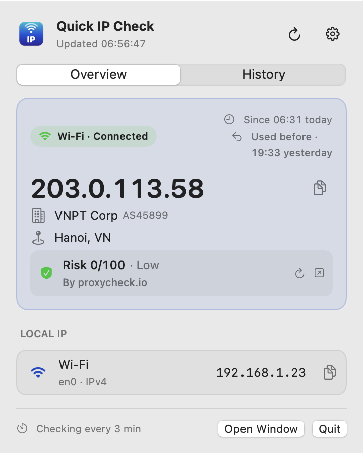
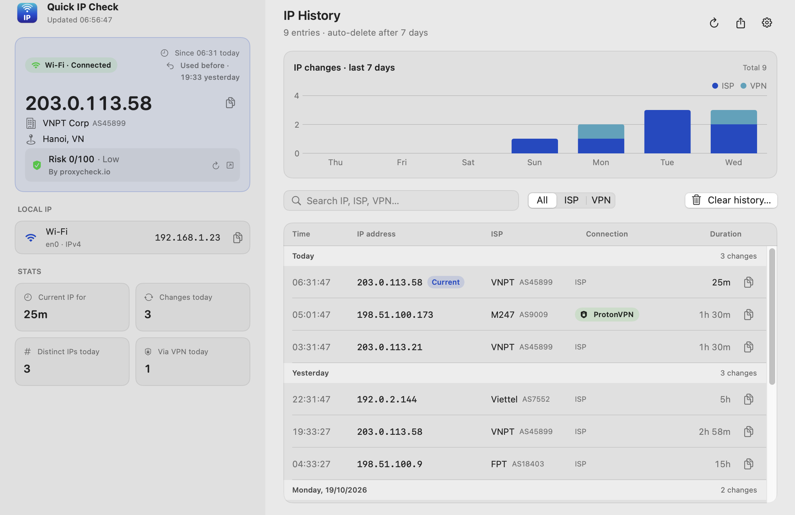
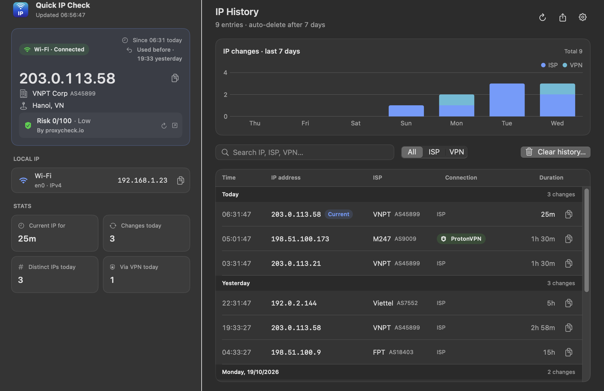
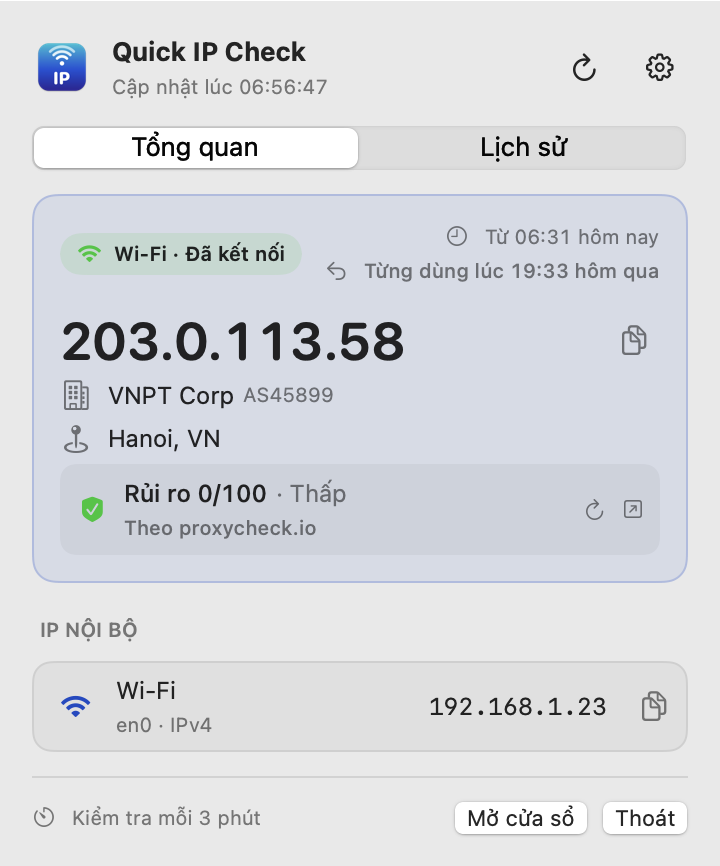
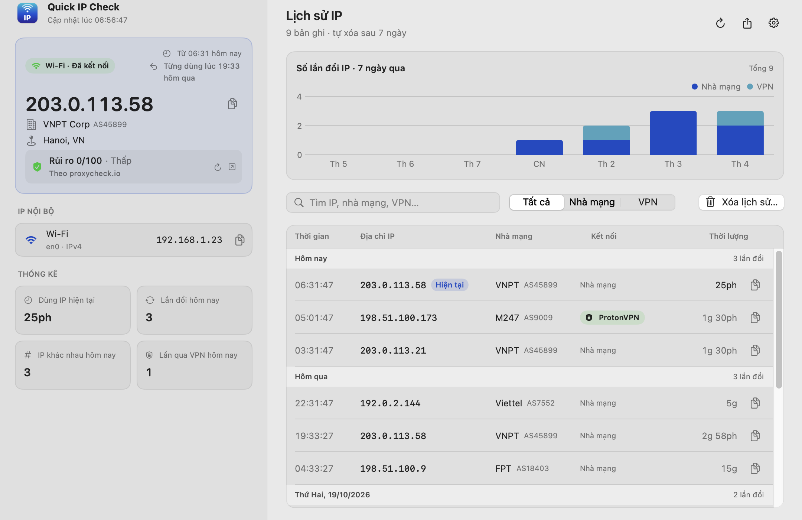

<p align="center">
  
</p>

<h1 align="center">Quick IP Check</h1>

<p align="center">
  Your public IP and ISP, right in the macOS menu bar.<br>
  Xem IP công khai và nhà mạng ngay trên thanh menu macOS.
</p>

<p align="center">
  <a href="https://github.com/Kaitiz/macos-quick-ip-check/releases/latest"><b>⬇ Download / Tải về</b></a>
  · macOS 13+ · Apple Silicon & Intel
</p>

<p align="center">
  
</p>

[English](#english) · [Tiếng Việt](#tiếng-việt)

---

## English

### Features

- **Menu bar at a glance** — shows `ISP · IP`, e.g. `VNPT · 203.0.113.58`. Make it shorter if you like: the IP in full, as `203…58`, `113.58` or just `58`, and the ISP by name or initials. Hover to see the full IP.
- **Main window** — open it like a regular app: the overview, today's stats, a 7-day chart of IP changes, and a searchable history table side by side.
- **Instant re-check** — notices when the network drops and comes back and checks right away; otherwise every 3 minutes (adjustable). Pauses while the Mac sleeps or the screen is locked.
- **Connection type** — "Wi-Fi · Connected", "Ethernet · Connected"…
- **VPN aware** — the menu bar shows your current public (VPN) IP, or `ISP → VPN` if you prefer; the overview shows both. Names the VPN in use (e.g. NordVPN, ProtonVPN) and recognises Tailscale exit nodes.
- **IP history** — recorded only when your IP changes, with how long each IP was used and whether it came through a VPN. Auto-cleanup after 6 hours to 1 month, optional entry limit, CSV export.
- **Returning IP** — tells you when you get an IP you used before (A → B → C → A).
- **Change popup** — a small notification when your IP changes, for 1–5 seconds, top left / center / right.
- **IP reputation** — risk score from proxycheck.io, fFraud, ip-api.com or StopForumSpam (no key needed), or AbuseIPDB and IPQualityScore (free API key).
- **Local IPs** — IPv4 / IPv6 per network interface.
- **One-click updates** — downloads, verifies and installs new versions when you agree.
- **English & Vietnamese**, light & dark mode, open at login.

<p align="center">
  
</p>
<p align="center">
  
</p>

### Install

1. Download the latest `.dmg` from [Releases](https://github.com/Kaitiz/macos-quick-ip-check/releases/latest).
2. Open it and drag **Quick IP Check** into **Applications**.
3. Open the app from Applications. It lives in the menu bar.

**"Apple could not verify Quick IP Check…"** — the app is not signed with a paid Apple Developer certificate, so macOS asks for confirmation the first time:

- Open **System Settings → Privacy & Security**, scroll down and click **Open Anyway** next to Quick IP Check, then confirm.
- Or run once in Terminal:
  ```sh
  xattr -dr com.apple.quarantine "/Applications/Quick IP Check.app"
  ```

You only need to do this once.

### Usage

- **Left click** the menu bar item: overview, local IPs and history. **Open Window** opens the main window.
- **Right click**: refresh, copy IP, main window, settings, quit.
- Shortcuts: `⌘R` refresh · `⌘O` main window · `⌘1` / `⌘2` switch tabs · `⌘,` settings.

### Default settings

Open at login · system language · check every 3 minutes, paused while asleep or locked · full IP with the ISP's main name, no logo · local IPv4 only · 2-second popup at the top center, with returning-IP notes · VPN IP only in the menu bar, VPN and Tailscale detection on · reputation by proxycheck.io, source shown · history kept 7 days, no entry limit · automatic update checks.

### Privacy

Quick IP Check has no account, no analytics and no server of its own. To do its job it contacts:

| Purpose | Service | What is sent |
|---|---|---|
| Find your public IP | api.ipify.org (fallback: icanhazip.com, checkip.amazonaws.com) | a plain request |
| ISP and location | ipinfo.io | your public IP |
| Reputation score (optional) | the service you choose | your public IP, only when it changes |
| Updates (optional) | api.github.com, github.com | a plain request, once a day; the new version when you choose to update |

VPN detection runs entirely on your Mac. History and settings stay on your Mac (`~/Library/Application Support/IPCheck/`). API keys are stored in the macOS Keychain.

### License

Free to use and share unmodified. Modified or renamed redistribution is not allowed. See [LICENSE](LICENSE).

Contact: [contact@lelong.dev](mailto:contact@lelong.dev)

---

## Tiếng Việt

<p align="center">
  
</p>

### Tính năng

- **Xem nhanh trên thanh menu**: hiện `Nhà mạng · IP`, ví dụ `VNPT · 203.0.113.58`. Có thể rút gọn: IP đầy đủ, dạng `203…58`, `113.58` hoặc chỉ `58`; tên nhà mạng đầy đủ hoặc viết tắt. Rê chuột để xem IP đầy đủ.
- **Cửa sổ chính**: mở như một ứng dụng bình thường, gồm tổng quan, thống kê trong ngày, biểu đồ số lần đổi IP 7 ngày và bảng lịch sử có tìm kiếm.
- **Kiểm tra lại ngay**: phát hiện khi mất mạng rồi có mạng lại và kiểm tra ngay; ngoài ra kiểm tra định kỳ 3 phút một lần (có thể chỉnh). Tạm dừng khi Mac ngủ hoặc khóa màn hình.
- **Loại kết nối**: "Wi-Fi · Đã kết nối", "Ethernet · Đã kết nối"…
- **Nhận biết VPN**: thanh menu hiện IP công khai hiện tại (IP VPN), hoặc `Nhà mạng → VPN` nếu bạn muốn; mục Tổng quan hiện cả hai. App nhận ra tên VPN đang dùng (ví dụ NordVPN, ProtonVPN) và Tailscale Exit Node.
- **Lịch sử IP**: chỉ ghi khi IP thay đổi, kèm thời gian sử dụng từng IP và có đi qua VPN hay không. Tự xóa sau 6 giờ đến 1 tháng, có thể giới hạn số bản ghi, xuất ra CSV.
- **IP quay lại**: báo khi bạn nhận lại một IP đã từng dùng (A → B → C → A).
- **Popup khi đổi IP**: thông báo nhỏ hiện 1–5 giây, ở góc trên bên trái, giữa hoặc bên phải.
- **Độ tin cậy IP**: điểm rủi ro từ proxycheck.io, fFraud, ip-api.com hoặc StopForumSpam (không cần key), hoặc AbuseIPDB và IPQualityScore (API key miễn phí).
- **IP nội bộ**: IPv4 / IPv6 theo từng cổng mạng.
- **Cập nhật một chạm**: khi bạn đồng ý, app tự tải, kiểm tra và cài bản mới.
- **Tiếng Việt & tiếng Anh**, giao diện sáng/tối, chạy cùng macOS.

<p align="center">
  
</p>

### Cài đặt

1. Tải file `.dmg` mới nhất tại [Releases](https://github.com/Kaitiz/macos-quick-ip-check/releases/latest).
2. Mở file, kéo **Quick IP Check** vào thư mục **Applications**.
3. Mở app từ Applications. App nằm trên thanh menu.

**"Apple could not verify Quick IP Check…"**: app chưa được ký bằng chứng chỉ Apple Developer (trả phí), nên lần đầu macOS sẽ hỏi xác nhận:

- Vào **Cài đặt hệ thống → Quyền riêng tư & Bảo mật**, kéo xuống dưới, bấm **Vẫn mở** cạnh Quick IP Check rồi xác nhận.
- Hoặc chạy một lần trong Terminal:
  ```sh
  xattr -dr com.apple.quarantine "/Applications/Quick IP Check.app"
  ```

Chỉ cần làm một lần.

### Sử dụng

- **Nhấn chuột trái** vào app trên thanh menu: tổng quan, IP nội bộ và lịch sử. Nút **Mở cửa sổ** mở cửa sổ chính.
- **Nhấn chuột phải**: làm mới, sao chép IP, cửa sổ chính, cài đặt, thoát.
- Phím tắt: `⌘R` làm mới · `⌘O` cửa sổ chính · `⌘1` / `⌘2` chuyển tab · `⌘,` cài đặt.

### Cài đặt mặc định

Chạy cùng macOS · ngôn ngữ theo hệ thống · kiểm tra mỗi 3 phút, tạm dừng khi Mac ngủ hoặc khóa màn hình · hiện IP đầy đủ kèm tên chính của nhà mạng, ẩn logo · chỉ hiện IPv4 nội bộ · popup 2 giây ở giữa phía trên, có báo IP đã từng dùng · khi dùng VPN chỉ hiện IP VPN, bật nhận biết nhà cung cấp VPN và Tailscale · chấm điểm bằng proxycheck.io, có hiện nơi chấm điểm · lưu lịch sử 7 ngày, không giới hạn số bản ghi · tự kiểm tra cập nhật.

### Quyền riêng tư

Quick IP Check không cần tài khoản, không thu thập thống kê và không có máy chủ riêng. App chỉ kết nối tới:

| Mục đích | Dịch vụ | Dữ liệu gửi đi |
|---|---|---|
| Lấy IP công khai | api.ipify.org (dự phòng: icanhazip.com, checkip.amazonaws.com) | yêu cầu thông thường |
| Nhà mạng và vị trí | ipinfo.io | IP công khai của bạn |
| Điểm tin cậy (tùy chọn) | dịch vụ bạn chọn | IP công khai, chỉ khi IP thay đổi |
| Cập nhật (tùy chọn) | api.github.com, github.com | yêu cầu thông thường, mỗi ngày một lần; tải bản mới khi bạn đồng ý cập nhật |

Việc nhận biết VPN diễn ra hoàn toàn trên máy bạn. Lịch sử và cài đặt chỉ lưu trên máy bạn (`~/Library/Application Support/IPCheck/`). API key được lưu trong Keychain của macOS.

### Giấy phép

Được dùng và chia sẻ miễn phí bản gốc. Không được chỉnh sửa rồi phát hành lại hay đổi tên. Xem [LICENSE](LICENSE).

Liên hệ: [contact@lelong.dev](mailto:contact@lelong.dev)
